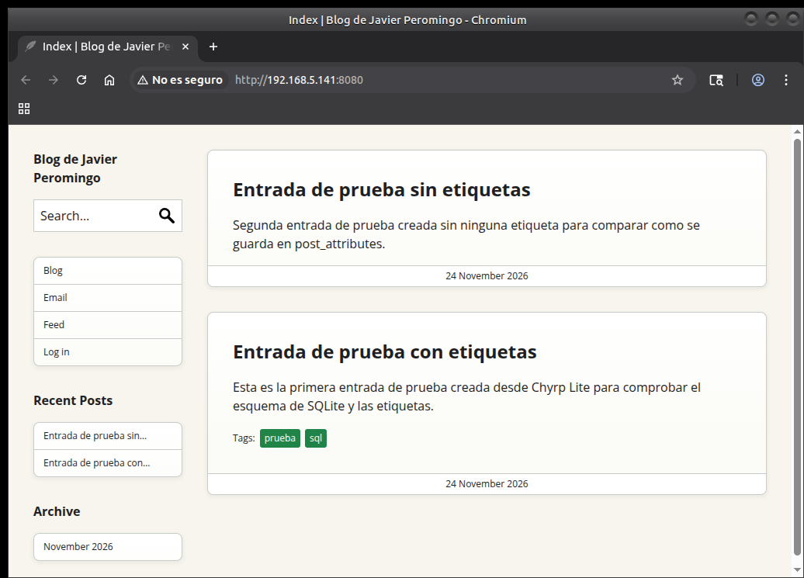
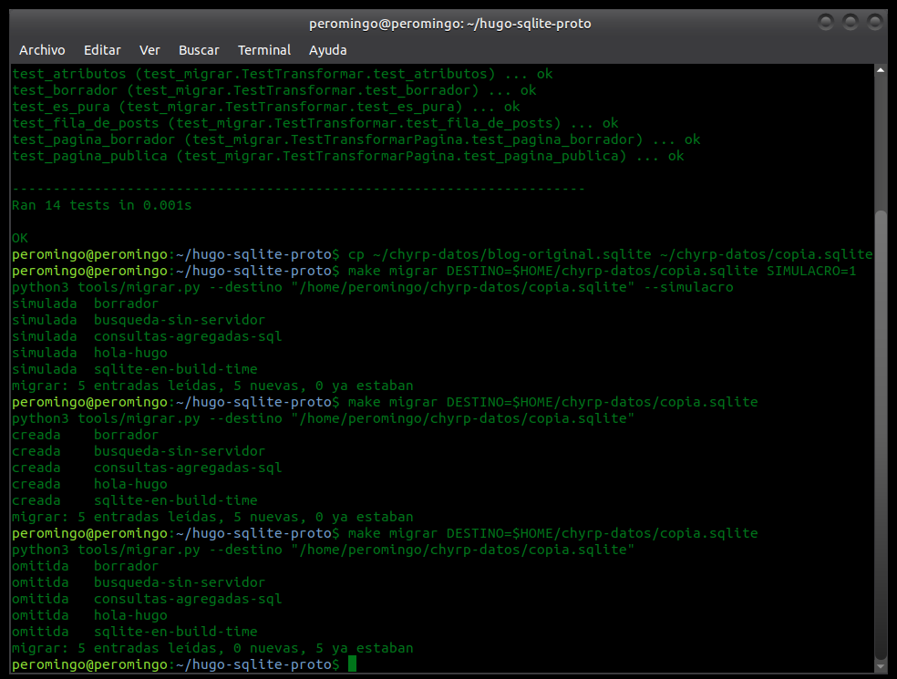
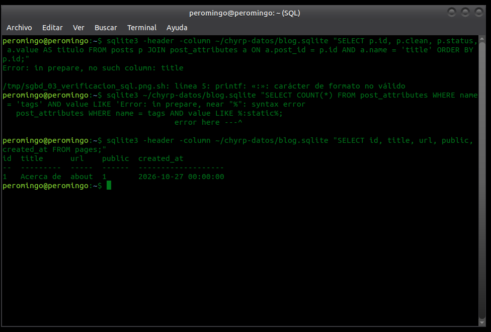
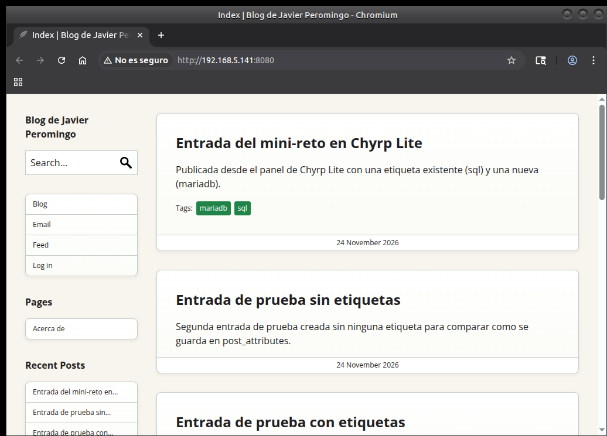
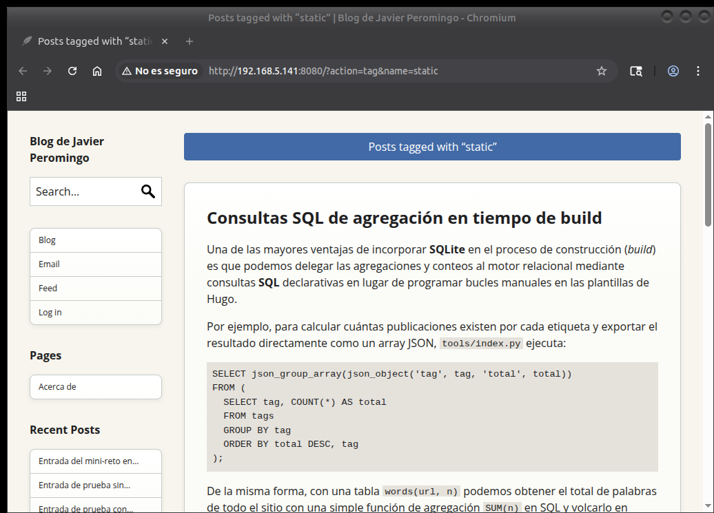
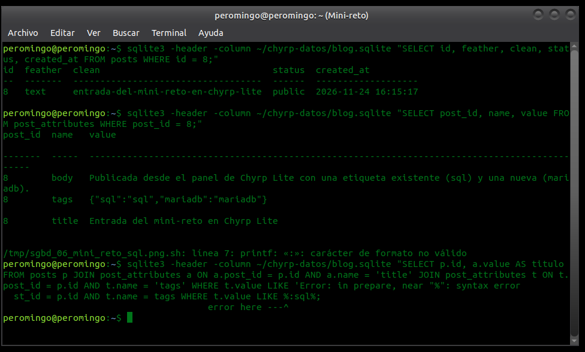

# Práctica SGBD P1.2: de Hugo + SQLite a Chyrp Lite + SQLite

- **Alumno:** Javier Peromingo
- **Curso:** 2º ASIR - SGBD
- **Repositorio (rama `chyrp-lite`):** https://github.com/javiperomingo/hugo-sqlite-proto/tree/chyrp-lite
- **Máquina virtual:** Debian 13 (`192.168.5.141`)

---

## 1. Instalación de Chyrp Lite con SQLite

### Tabla de datos (Parte 1)

| Dato | Valor |
|---|---|
| Versión de PHP (`php -v`) | PHP 8.4.28 (cli) |
| Versión de Chyrp Lite | v2026.03.01 |
| Ruta del fichero `.sqlite` | `/home/peromingo/chyrp-datos/blog.sqlite` (fuera de `~/chyrp`) |
| Captura de la portada con entradas de prueba | Ver imagen siguiente (`capturas/01_chyrp_portada_pruebas.png`) |

---

## 2. Exploración del esquema de Chyrp Lite

Trabajando sobre una copia (`/tmp/blog-copia.sqlite`) con `sqlite3`:

1. **¿Qué tablas hay y para qué sirve cada una?**
   Hay 7 tablas:
   - `posts`: guarda los metadatos comunes de cada entrada (tipo/feather, slug, url, estado, autor y fechas).
   - `post_attributes`: guarda los atributos variables de cada entrada en pares clave-valor (`title`, `body`, `tags`, etc.).
   - `pages`: guarda las páginas estáticas del blog (como "Acerca de"), con `title` y `body` directamente en columnas.
   - `users`: usuarios registrados del blog (login, contraseña, correo, grupo).
   - `groups`: roles o grupos de usuarios (administrador, miembro, invitado...).
   - `permissions`: permisos asignados a cada grupo.
   - `sessions`: sesiones activas de los usuarios que inician sesión.

2. **¿Cuántas filas ocupa cada entrada en cada tabla? ¿Dónde está el título y el cuerpo?**
   Cada entrada ocupa **1 fila** en `posts` y **3 filas** en `post_attributes` (una para `title`, otra para `body` y otra para `tags`). Tanto el título como el cuerpo están en `post_attributes.value`, identificados por `name = 'title'` y `name = 'body'`.

3. **¿Qué clave primaria tiene `post_attributes`? ¿Por qué es compuesta? ¿Qué clave foránea lleva?**
   Tiene clave primaria compuesta `PRIMARY KEY (post_id, name)`. Es compuesta porque una misma entrada (`post_id`) tiene varios atributos distintos, pero no puede repetir dos veces el mismo atributo (`name`). En el `CREATE TABLE` de SQLite no lleva declarada ninguna `FOREIGN KEY` explícita; la relación con `posts.id` la gestiona la propia aplicación PHP.

4. **¿Existe una tabla de etiquetas? ¿Cómo se guardan en `post_attributes`?**
   No existe una tabla de etiquetas propia. Se guardan en una fila de `post_attributes` con `name = 'tags'` y el valor serializado en JSON como objeto `{nombre: slug}`.
   - En la entrada con dos etiquetas (`prueba`, `sql`): `{"prueba":"prueba","sql":"sql"}`
   - En la entrada sin etiquetas: `[]`

5. **¿Cómo se guarda la fecha y qué valor tiene `updated_at` si nunca se editó?**
   Se guarda en formato `YYYY-MM-DD HH:MM:SS` (por ejemplo `2026-11-24 16:11:01`). Cuando una entrada nunca se ha editado, `updated_at` vale `1000-01-01 00:00:00`.

6. **¿Qué diferencia hay entre `clean` y `url` en `posts`? ¿Qué valores puede tomar `status`?**
   `clean` es el slug limpio generado a partir del título y `url` es el identificador único usado en la ruta del enlace permanente (normalmente coinciden, salvo si hay colisión y Chyrp Lite le añade un sufijo a `url`). En `status` los valores habituales son `public` (visible), `draft` (borrador), `private` o `scheduled`.

7. **Nota sobre EAV (`post_attributes`):**
   La ventaja del modelo EAV es que cualquier módulo o tipo de entrada (*feather*: texto, foto, enlace, cita...) puede añadir campos nuevos sin tener que modificar el esquema de la base de datos con `ALTER TABLE`. El inconveniente es que las consultas se complican (hacen falta varios `JOIN` o filtros sobre texto) y se pierden tipos estrictos y restricciones a nivel de base de datos.

---

## 3. Esquema del prototipo (P1.1) y correspondencia entre esquemas

Al ejecutar `make index` en `~/hugo-sqlite-proto` y revisar `build/site.db`:

1. **Clave primaria de `posts` y de `tags`:** En `posts` la clave primaria es `url` (`TEXT PRIMARY KEY`). En `tags` es compuesta `(url, tag)`.
2. **Relación entre entradas y etiquetas:** Es una relación 1:N (una entrada tiene varias filas en `tags`), donde la etiqueta es simplemente un texto en `tags.tag`, sin tabla independiente de catálogo de etiquetas.
3. **¿Qué contiene `posts.body`?** Contiene texto plano, no el Markdown original, porque `plain()` en `tools/index.py` limpia marcas de Markdown para la búsqueda.
4. **¿Qué pasa con `draft: true`?** Por defecto `tools/index.py` ignora los borradores, así que no aparecen en `build/site.db` salvo que se ejecute con `--drafts`.

### Tabla de correspondencia entre esquemas

| Prototipo (P1.1) | Chyrp Lite (tabla.columna o atributo) | Transformación necesaria |
|---|---|---|
| `title` (título) | `post_attributes` (`name='title'`, `value`) | Ninguna, se copia el texto |
| Cuerpo (Markdown del `.md`) | `post_attributes` (`name='body'`, `value`) | Leer del `.md` directamente (no de `site.db`) para no perder el formato Markdown |
| `date` (fecha) | `posts.created_at` | Completar a `YYYY-MM-DD HH:MM:SS` (añadir `00:00:00` si solo tiene fecha) |
| Nombre del fichero (`hola-hugo.md`) | `posts.clean` y `posts.url` | Quitar `.md` y normalizar a slug (`slugify`) |
| `description` / `summary` | Sin equivalente directo | No se migra (Chyrp Lite no tiene columna de resumen) |
| `tags` (lista en YAML) | `post_attributes` (`name='tags'`, `value`) | Pasar la lista a JSON `{nombre: slug}` o `[]` si está vacía |
| `draft: true` | `posts.status` | `draft` si es `true`, `public` si es `false` |
| Autor | `posts.user_id` | No existe en el prototipo; se asigna el `id` del usuario de Chyrp Lite (por defecto el primero) |
| Columnas sin origen (`feather`, `pinned`, `updated_at`) | `posts.feather`, `posts.pinned`, `posts.updated_at` | Valores fijos: `'text'`, `0` y `'1000-01-01 00:00:00'` |

---

## 4. Lectura guiada del script `tools/migrar.py` (4.4)

1. **¿Qué funciones tocan el disco o SQL y cuáles no? ¿Por qué `test_migrar.py` no necesita BD?**
   - **Puras (sin disco ni SQL):** `slugify`, `fecha_chyrp`, `etiquetas_json` y `transformar` (y `transformar_pagina` añadida en el ejercicio 2).
   - **Con efectos (disco o SQL):** `leer_entrada`, `extraer`, `comprobar_destino`, `buscar_autor`, `existe`, `insertar` y `cargar`.
   `test_migrar.py` puede probar `transformar` sin base de datos porque recibe un diccionario en memoria y devuelve otro diccionario sin depender de ficheros ni de SQLite.

2. **¿Dónde empieza y termina la transacción? ¿Qué pasa si falla el 3.er `INSERT`?**
   La transacción se controla en `cargar()` con `with con:`. Empieza al entrar en el bloque `with` y hace `commit` al salir si no hay excepciones. Si fallase el `INSERT` de la 3.ª entrada, SQLite hace `rollback` automático y se deshacen también la 1.ª y la 2.ª entrada, dejando la BD como estaba.

3. **¿Qué columna usa para detectar si una entrada ya está migrada? ¿Qué problema puede tener?**
   Usa `posts.url` (`SELECT 1 FROM posts WHERE url = ?`). Como `url` viene de `path.stem` (el nombre del archivo sin extensión), sirve bien para un blog plano, pero si hubiera dos archivos con el mismo nombre en subcarpetas distintas (por ejemplo `2025/notas.md` y `2026/notas.md`), el segundo se omitiría al tener el mismo `url`.

4. **¿Por qué `etiquetas_json` devuelve `[]` y no `{}` cuando no hay etiquetas?**
   Porque en PHP un array vacío serializado con `json_encode([])` produce `[]`, que es justo lo que vimos en la entrada de prueba sin etiquetas en `post_attributes`.

5. **¿Por qué `updated_at` vale `1000-01-01 00:00:00`?**
   Es la constante `SQL_DATETIME_ZERO` que usa Chyrp Lite internamente para indicar que una entrada nunca ha sido modificada después de crearse.

6. **¿Por qué se usa `cur.lastrowid` entre los dos `INSERT`?**
   Porque `posts.id` es `AUTOINCREMENT`: al insertar en `posts` SQLite genera el `id` nuevo, y `cur.lastrowid` devuelve ese `id` para poder insertar los atributos (`title`, `body`, `tags`) en `post_attributes` con el `post_id` correcto.

7. **Comparación de `transformar` con la tabla de la Parte 3:**
   Coincide en los campos principales (`posts` + los 3 atributos en `post_attributes`, `status`, fechas y `SQL_DATETIME_ZERO`). Un detalle que no había previsto antes de ver el código es el escape de `/` como `\/` en `etiquetas_json` para igualar exactamente lo que genera PHP.

---

## 5. Ejecución y verificación de la migración

Se creó la rama `chyrp-lite` en el fork `hugo-sqlite-proto`, se ejecutaron las pruebas unitarias (`make test`), el simulacro (`SIMULACRO=1`), la migración real y una segunda ejecución para comprobar la idempotencia (`omitida`), siempre sobre una copia de la BD antes de sustituir `blog.sqlite`.

### Verificación en SQL

Tras pasar la copia migrada a `~/chyrp-datos/blog.sqlite` (guardando `blog-original.sqlite` como respaldo), se lanzaron las consultas de verificación:

- Total de entradas migradas del prototipo: 5 (4 públicas + 1 borrador `borrador` con `status = draft`), más las 2 de prueba y la del mini-reto (8 en total al final).
- Total de entradas con la etiqueta `static`: **4**, exactamente el mismo número que aparece en `data/tags.json` del prototipo (`{"tag":"static","total":4}`).

### Verificación en el navegador (como visitante)

| Comprobación | Resultado |
|---|---|
| Entradas visibles en la portada | Se ven las públicas (las 4 del prototipo, las 2 de prueba y la del mini-reto); el borrador no sale |
| Entrada con varias etiquetas | Se muestran todas sus etiquetas correctamente |
| Página de etiqueta (`/?action=tag&name=static`) | Lista las 4 entradas con etiqueta `static`, igual que en `data/tags.json` |
| Fecha de entradas antiguas | Conservan su fecha original (octubre/noviembre 2026) |
| Formato Markdown del cuerpo | Negritas, enlaces y bloques de código renderizados correctamente |
| Entrada en borrador (`borrador`) | Oculta para visitantes, visible en el panel de administración |
| Repetir `make migrar` | Todas salen como `omitida` y no se duplica ninguna fila |

---

## 6. Ejercicios resueltos

### Ejercicio 2: Migrar las páginas (`content/about.md` -> tabla `pages`)

- **Qué cambié:**
  Revisé `.schema pages` en la BD de Chyrp Lite y comprobé que, a diferencia de `posts`, las páginas guardan `title` y `body` directamente en la propia tabla `pages` (sin tabla de atributos). Añadí en `tools/migrar.py`:
  - La función pura `transformar_pagina(entrada, user_id, ahora)` para mapear un `.md` a las columnas de `pages` (`title`, `body`, `public`, `show_in_list`, `list_order`, `clean`, `url`, `user_id`, `parent_id`, `created_at`, `updated_at`).
  - `extraer_paginas(origen)`, `existe_pagina`, `insertar_pagina` y `cargar_paginas` (transaccional e idempotente comprobando `pages.url`), activables con `--paginas content`.
  - Dos pruebas unitarias nuevas (`TestTransformarPagina`) en `tools/test_migrar.py` (página pública y página en borrador).
- **Qué esperaba y cómo lo comprobé:**
  Esperaba que `content/about.md` apareciera en la tabla `pages` y en el menú lateral *Pages* del blog. Pasé `make test` (OK), ejecuté `python3 tools/migrar.py --destino ~/chyrp-datos/blog.sqlite --paginas content` (mostró `creada pagina:about`), verifiqué la fila en SQLite (`1|Acerca de|about|1|2026-10-27 00:00:00`) y comprobé en el navegador que aparece el enlace **Acerca de** en la barra lateral (visible en la captura de portada).

### Ejercicio 5: Descubre un límite (etiqueta numérica `2026`)

- **Qué cambié:**
  Revisé `modules/tags/tags.php` (`prepare_tags`) en Chyrp Lite y probé con PHP cómo serializa una etiqueta puramente numérica como `2026`. Descubrí que Chyrp Lite hace dos cosas para evitar que PHP convierta `"2026"` en un índice entero de array:
  1. Antepone el carácter Unicode `U+FE0E` a la clave (`"\ufe0e2026"`).
  2. Como el slug solo tendría dígitos, en vez de usar `"2026"` calcula `md5("\ufe0e2026")` (`a3a10ebe2ba87b81b32702fce0637e74`).
  Antes de corregirlo, `etiquetas_json(["2026"])` devolvía `{"2026":"2026"}`, que no coincidía con Chyrp Lite. Modifiqué `etiquetas_json` en `tools/migrar.py` usando `hashlib.md5` para replicar exactamente ese comportamiento y añadí la prueba `test_etiqueta_numerica` en `tools/test_migrar.py`.
- **Qué esperaba y cómo lo comprobé:**
  Esperaba que `etiquetas_json(["2026"])` devolviera exactamente `{"\ufe0e2026":"a3a10ebe2ba87b81b32702fce0637e74"}` (igual que `php -r '$v = "\u{FE0E}2026"; echo json_encode([$v => md5($v)]);'`). Ejecuté `make test` y pasaron los 14 tests en verde.

---

## 7. Mini-reto: crear una entrada nueva y mirarla en la BD

Desde el panel *Write* de Chyrp Lite se publicó la entrada *"Entrada del mini-reto en Chyrp Lite"* con dos etiquetas: `sql` (ya existente) y `mariadb` (nueva).

Al consultarla en `sqlite3`:
- Se creó **1 fila** en `posts` (`id = 8`).
- Se crearon **3 filas** en `post_attributes` (`title`, `body` y `tags` con valor `{"sql":"sql","mariadb":"mariadb"}`).
- Al ser un modelo EAV, una sola entrada siempre genera una fila base en `posts` más una fila por cada atributo en `post_attributes`.
- La etiqueta nueva `mariadb` no crea ningún registro en una tabla aparte: simplemente se añade al texto JSON de la fila `tags` de esa entrada.
- Para buscar todas las entradas con la etiqueta `sql`, en Chyrp Lite hay que hacer `LIKE '%:"sql"%'` sobre el JSON serializado en `post_attributes`, mientras que en el prototipo P1.1 bastaba con un `JOIN` limpio sobre `tags` (`WHERE t.tag = 'sql'`).

---

## 8. Preguntas para reflexionar

1. **¿Qué pasaba si SQLite fallaba en la P1.1 vs ahora en Chyrp Lite?**
   En la P1.1 SQLite solo se usaba al construir el sitio; en producción el servidor servía HTML y JSON estáticos, así que si SQLite fallaba la web seguía funcionando sin problemas. En Chyrp Lite PHP consulta la base de datos en cada visita, así que si el fichero `.sqlite` se corrompe, se borra o se bloquea, el blog entero deja de funcionar.

2. **Concurrencia con 50 usuarios a la vez y cuándo pasar a MySQL/PostgreSQL:**
   SQLite bloquea el fichero al escribir. Para 50 usuarios solo leyendo suele aguantar bien, pero si varios usuarios o procesos intentan escribir a la vez (comentarios, sesiones, publicaciones) aparecen errores de `database is locked` y esperas. Tendría sentido pasar a MySQL o PostgreSQL cuando haya escrituras concurrentes frecuentes, varios servidores web compartiendo la misma BD o mucho tráfico simultáneo.

3. **Copia de seguridad en Chyrp Lite vs P1.1:**
   En Chyrp Lite la fuente de la verdad es la BD, así que es obligatorio copiar `/home/peromingo/chyrp-datos/blog.sqlite` (y la carpeta de archivos subidos si hubiera imágenes) y preferiblemente con `sqlite3 ... ".backup ..."` para no copiarla a medias. En la P1.1 `build/site.db` se podía borrar sin perder nada porque todo el contenido estaba en los `.md` bajo Git.

4. **Normalización (1FN) en etiquetas:**
   Al guardar varias etiquetas juntas en un único campo JSON, Chyrp Lite incumple la primera forma normal (valores no atómicos). Esto hace mucho más difíciles consultas como contar cuántas entradas tiene cada etiqueta (`GROUP BY`), renombrar una etiqueta globalmente o usar índices normales. A cambio, Chyrp Lite gana simplicidad de esquema y flexibilidad para activar/desactivar el módulo de etiquetas sin crear ni borrar tablas.

5. **Riesgos de escribir directo en las tablas de otra aplicación:**
   Al hacer `INSERT` directos nos saltamos las validaciones de la aplicación, hooks de módulos, limpieza de caché o formatos especiales (como vimos en el ejercicio 5 con las etiquetas numéricas). Si Chyrp Lite ofreciera una API REST o un importador oficial, sería más seguro usarlo porque garantizaría que todos los datos pasan por la lógica del CMS.

6. **¿Por qué no servía el módulo Migration de Chyrp Lite?**
   Porque sus importadores solo entienden formatos de otros CMS (WordPress, Tumblr, TextPattern, MovableType), no carpetas de archivos Markdown con *front matter* YAML de Hugo ni el esquema de `build/site.db`. Para importar un sitio Hugo tendría que leer ficheros `.md`, separar el *front matter* YAML del cuerpo Markdown y mapear título, fecha, borrador y etiquetas a las tablas de Chyrp Lite.
